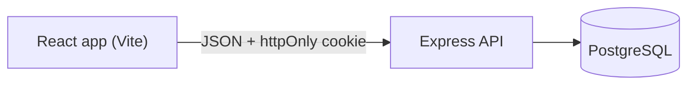

# JobPilot

A full-stack job-search tracker: discover jobs, save the interesting ones, and track every application on a Kanban board, with status history and a dashboard.


**Live demo:** [FILL IN after deployment] · **Demo login:** [FILL IN or remove]

[FILL IN: 2 or 3 screenshots, e.g. the Kanban board and the dashboard, saved in a /docs folder]

## Features

- Sign up / log in with cookie-based sessions
- Search jobs with full-text search, filters, sorting and pagination
- Save jobs, then turn them into tracked applications (prefilled from the listing)
- Drag-and-drop Kanban board (Saved, Applied, Online Assessment, Interview, Offer, Rejected, Withdrawn)
- Full status history for every application
- Dashboard with totals, in-progress count, offers and response rate

## Tech stack

| Area | Technology |
|---|---|
| Frontend | React, TypeScript, Vite, Tailwind CSS v4, React Router, TanStack Query, React Hook Form, Zod |
| Backend | Node.js, Express 5, TypeScript, Zod |
| Database | PostgreSQL (full-text search with a GIN index) |
| Testing / CI | Vitest, Supertest (real database), GitHub Actions |

## Architecture



Request flow in the backend: route, then validation (Zod), then controller, then service (SQL), then response.

## API overview

All routes are under `/api/v1`. Everything except signup, login and logout requires a login.

| Method | Path | Purpose |
|---|---|---|
| POST | `/auth/signup`, `/auth/login`, `/auth/logout` | Account and session |
| GET | `/auth/me` | Current user |
| GET | `/jobs` | Search, filter, sort, paginate (`q`, `location`, `experienceLevel`, `employmentType`, `source`, `sort`, `page`, `pageSize`, `saved`) |
| GET | `/jobs/:id` | Job details |
| POST / DELETE | `/jobs/:id/save` | Save / unsave a job |
| GET / POST | `/applications` | List / create applications |
| GET / PATCH / DELETE | `/applications/:id` | One application |
| GET | `/applications/:id/events` | Status history |
| GET | `/analytics/overview` | Dashboard numbers |

## Getting started

**You need:** Node.js 22+ and PostgreSQL 16+.

1. Create the database and user (in `psql` or pgAdmin):
   ```sql
   CREATE ROLE jobpilot LOGIN PASSWORD 'jobpilot';
   CREATE DATABASE jobpilot OWNER jobpilot;
   CREATE DATABASE jobpilot_test OWNER jobpilot;  -- used by the automated tests
   ```
2. Backend:
   ```bash
   cd backend
   cp .env.example .env          # then set JWT_SECRET to a long random string
   npm install
   # create the tables: run the files in backend/db in order (001_..., 002_...)
   psql -U jobpilot -d jobpilot -h localhost -f db/001_schema.sql
   psql -U jobpilot -d jobpilot -h localhost -f db/002_full_text_search.sql
   npm run db:seed -- 40         # sample jobs
   npm run dev                   # http://localhost:4000
   ```
3. Frontend:
   ```bash
   cd frontend
   cp .env.example .env.local
   npm install
   npm run dev                   # http://localhost:5173
   ```

### Environment variables (backend)

| Variable | Meaning |
|---|---|
| `PORT` | API port (default 4000) |
| `DATABASE_URL` | PostgreSQL connection string |
| `JWT_SECRET` | Secret used to sign login tokens, keep private |
| `CLIENT_URL` | Frontend origin allowed by CORS |
| `NODE_ENV` | `development` or `production` (production makes cookies `secure`) |

## Testing

```bash
cd backend
npm test          # [FILL IN: number] integration tests against the jobpilot_test database
npm run typecheck
```

Tests make real HTTP requests to the app and use a real PostgreSQL database that is rebuilt before each run. They cover authentication, per-user data isolation, status history, search and the rate limiter. GitHub Actions runs typecheck, tests and builds on every push.

## Performance

Job search on 50,000 seeded rows: PostgreSQL full-text search with a GIN index brought the query from [FILL IN: your before] ms to [FILL IN: your after] ms (measured with `EXPLAIN ANALYZE`).

## Design decisions

> Write each one in your own words, 2 or 3 sentences. Delete any you can't explain.

- **Session in an httpOnly cookie, not localStorage.** [Why? What attack does it make harder? What did it cost you, e.g. CORS settings?]
- **Transactions for status changes.** [Which two writes must succeed together, and what goes wrong without a transaction?]
- **Ownership check in every query, and 404 instead of 403.** [What does a missing `user_id` filter allow? Why not reveal that the record exists?]
- **Full-text search with a GIN index.** [Why is `LIKE '%x%'` slow? What did you give up, e.g. substring matches?]
- **Optimistic updates on the Kanban board.** [What does the user see, and what happens if the request fails?]
- **Rate limiting on login and signup.** [Why count only failed logins? What would you change with several servers?]
- **Integration tests on a real database.** [Why not mocks? How do you keep tests from affecting each other?]

## Limitations and next steps

- Job data is seeded sample data; there is no real job-provider integration.
- Login tokens last 7 days and can't be revoked before they expire; logout only clears the cookie. (Fix: short-lived tokens plus a refresh-token table.)
- No email verification or password reset.
- No CSRF tokens; protection relies on `SameSite=Lax` cookies and a JSON-only API.
- The rate limiter keeps counts in memory, so it works for one server only (fix: a shared store such as Redis).
- The applications list is not paginated.